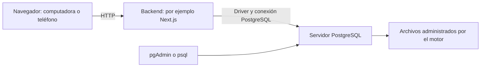

# 1. Entender las piezas antes de instalar

Una base de datos conserva información y permite consultarla siguiendo reglas. PostgreSQL es el programa que administra esa información. SQL es el lenguaje con el que le pedimos operaciones; no es un programa que debamos mantener abierto.

## Modelo cliente y servidor



El navegador pide acciones al backend. El backend valida quién puede hacerlas y consulta PostgreSQL mediante un **driver**, una biblioteca que habla su protocolo. pgAdmin y psql son otros clientes del mismo servidor: una interfaz gráfica y una terminal, respectivamente. Cerrar pgAdmin no equivale a detener PostgreSQL.

Todo puede correr en una computadora. Si otro teléfono abre la aplicación en la red local, normalmente se conecta al backend; no necesita acceder directamente al puerto de PostgreSQL. Este diseño es una propuesta de aplicación, no una obligación del motor.

## Qué contiene qué

| Concepto | Significado |
| --- | --- |
| Servidor o instancia | Programa en ejecución que atiende conexiones. |
| Clúster PostgreSQL | Conjunto de bases administradas por una instancia; aquí no significa necesariamente varias computadoras. |
| Base de datos | Contenedor al que se conecta una sesión. |
| Esquema | Espacio de nombres dentro de una base; organiza objetos. |
| Tabla | Filas y columnas con tipos y restricciones. |
| Rol | Identidad con permisos; los roles pertenecen al clúster. |

## Qué ocurre al ejecutar una consulta

El servidor interpreta SQL, comprueba permisos y prepara un plan de ejecución. El ejecutor sigue ese plan para acceder a los datos. Los índices pueden ayudar a encontrarlos, pero cuestan espacio y trabajo al escribir; tener uno no obliga al planificador a usarlo.

Para investigar un plan usamos `EXPLAIN`. `EXPLAIN ANALYZE` **sí ejecuta** la sentencia: no lo pruebes sobre escrituras de producción como si fuera solo una explicación.

## Comprobación propuesta

Cuando tengas conexión, ejecuta:

```sql
SELECT version(), current_database(), current_user;
SHOW port;
SHOW search_path;
```

Esperamos identificar la versión del servidor, la base, el rol, el puerto y los esquemas de búsqueda. No asumimos valores concretos: regístralos sin credenciales. El puerto habitual es 5432, pero tu instalación puede usar otro.

Puedes explicar esta etapa si sabes responder: ¿por qué instalar pgAdmin no basta para tener un servidor?, ¿a qué programa se conecta el teléfono?

Fuentes: [arquitectura cliente/servidor](https://www.postgresql.org/docs/18/tutorial-arch.html), [organización de bases](https://www.postgresql.org/docs/18/managing-databases.html), [esquemas](https://www.postgresql.org/docs/18/ddl-schemas.html), [EXPLAIN](https://www.postgresql.org/docs/18/using-explain.html).
