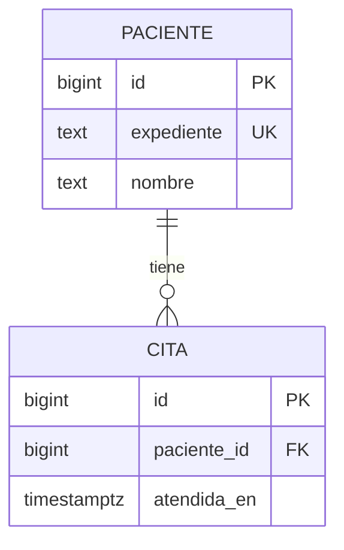

# 3. De los datos a las relaciones

Una fila representa un registro y una columna un atributo con un tipo. El tipo limita qué valores pueden guardarse; una restricción expresa una regla adicional.

| Regla | Herramienta de SQL | Ejemplo didáctico |
| --- | --- | --- |
| Identificar una fila | `PRIMARY KEY` | ID interno del paciente. |
| Evitar duplicados | `UNIQUE` | Código de expediente único. |
| Exigir un valor | `NOT NULL` | Nombre obligatorio. |
| Validar una condición | `CHECK` | Nombre sin quedar vacío al quitar espacios. |
| Vincular registros existentes | `FOREIGN KEY` | Cita asociada a un paciente. |

`UNIQUE` y `NOT NULL` son reglas distintas. Un teléfono conviene tratarlo como texto: puede tener prefijo, guiones y ceros iniciales; no es una cantidad sobre la que sumemos.

## Una relación pequeña para aprender



Un paciente puede tener cero o muchas citas; cada cita del ejercicio pertenece a un paciente. La clave foránea evita referencias inexistentes. No elegimos eliminación en cascada: borrar un paciente no debería arrastrar su historial por accidente.

El ID técnico y el expediente visible pueden tener responsabilidades distintas. Declarar único el expediente no lo vuelve inmutable: impedir cambios requiere una regla adicional en el sistema. Este ejemplo no decide esa política para una clínica.

`timestamptz` representa un instante y lo muestra según la zona horaria de la sesión; no conserva el nombre de la zona original. Una fecha sin hora puede usar `date`. La presentación «20 de octubre de 2026, 9:30 a. m.» corresponde a la interfaz, no a guardar ese texto como fecha.

## Practicar

Ejecuta el [laboratorio 1](../laboratorios/01-primeras-consultas.sql) desde la raíz del repositorio:

```powershell
psql -X -h localhost -p 5432 -U aprendiz -d aprendizaje_pg -W -v ON_ERROR_STOP=1 -f laboratorios/01-primeras-consultas.sql
```

El archivo crea tablas temporales en una transacción y termina con `ROLLBACK`. No crea tablas permanentes. Usa una conexión exclusiva de práctica: no lo pegues dentro de una transacción que necesites conservar.

Resultado esperado: dos pacientes, una cita y una consulta que incluye al paciente sin citas mediante `LEFT JOIN`. Las comprobaciones lanzan un error si los conteos o las restricciones no coinciden. La última operación revierte el ejercicio; si algo falla, cerrar esa conexión descarta su transacción pendiente.

Antes de ejecutar, predice qué ocurriría con dos expedientes iguales y con una cita de un paciente inexistente. Después explica por qué `LEFT JOIN` permite ver pacientes sin citas.

Fuentes: [restricciones](https://www.postgresql.org/docs/18/ddl-constraints.html), [consultas entre tablas](https://www.postgresql.org/docs/18/tutorial-join.html), [fechas y horas](https://www.postgresql.org/docs/18/datatype-datetime.html).
