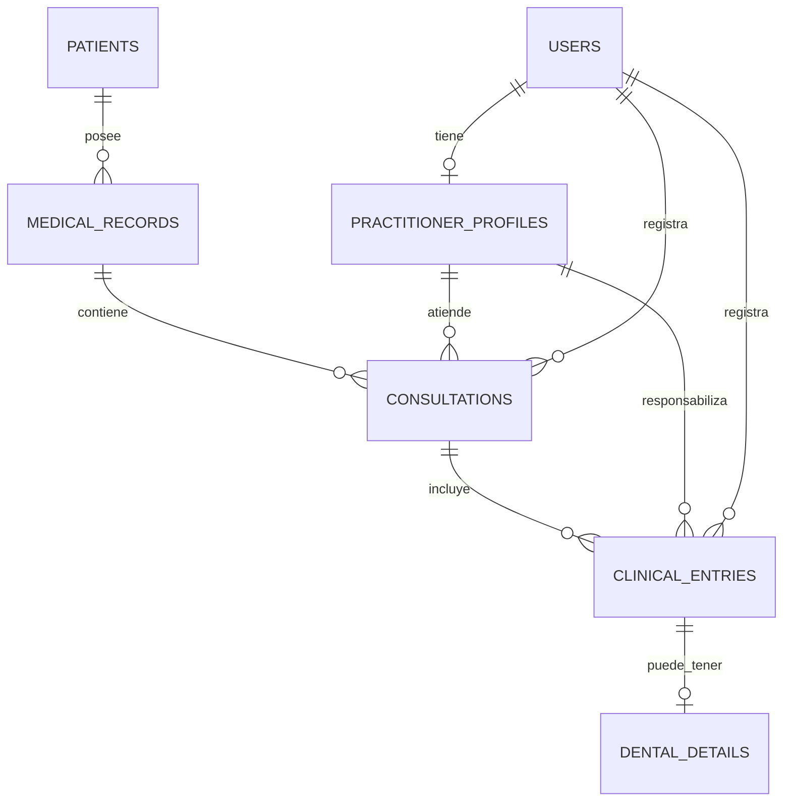

# 7. Caso de estudio: pacientes, expedientes y autores

Estado: **propuesta para conversar, no esquema aprobado ni implementado**. Fecha: 1 de noviembre de 2026. Se basa en preguntas del usuario y en los campos mock de OdontoSoft; no en datos reales. No es una recomendación clínica.
**Decisión vigente:** nombres técnicos en inglés, relación `patients → medical_records` uno a muchos en BD y flujo inicial limitado a un expediente. Campos obligatorios propuestos y control de concurrencia en [campos obligatorios](10-required-fields.md). Esta decisión sustituye la unicidad de `patient_id` planteada inicialmente.

Actualización: las decisiones posteriores están en [tablas y relaciones](09-tablas-y-relaciones.md). Un expediente por paciente y un médico responsable por consulta quedan como reglas iniciales; las colaboraciones se anotan en comentarios.

## Separar identidad, atención y autoría

Un usuario es una cuenta que puede entrar al sistema. Un perfil médico contiene información profesional y pertenece a una cuenta. Proponemos que una cuenta tenga cero o un perfil médico: recepción puede registrar información sin ser el médico que atiende. Para esta primera propuesta, un paciente no necesita una cuenta de acceso.

Un paciente representa a la persona atendida. Su expediente agrupa información clínica y consultas dentro de esta instalación. Proponemos un expediente por paciente; esta regla necesita confirmación.

## Tablas candidatas

Los identificadores con sufijo `_id` vinculan registros; se usarán UUID v4 aleatorios para las claves internas. Los campos siguientes describen responsabilidades, no son DDL final. Los campos obligatorios vigentes se detallan en [campos obligatorios](10-required-fields.md).

| Tabla                   | Información principal                                                                                                                                                                              |
| ----------------------- | -------------------------------------------------------------------------------------------------------------------------------------------------------------------------------------------------- |
| `users`                 | Identidad de acceso, nombre visible, estado activo y rol de acceso inicial por definir. Nunca contraseñas en texto plano.                                                                          |
| `practitioner_profiles` | `user_id` único, identificación profesional y especialidad si se necesitan.                                                                                                                        |
| `patients`              | Nombre, identificación y teléfono, actualmente presentes en la interfaz.                                                                                                                           |
| `medical_records`       | `patient_id` requerido y no único, código visible único e inmutable, antecedentes, observaciones generales, quién lo creó y cuándo, archivado.                                                     |
| `consultations`         | `medical_record_id`, médico responsable, fecha/hora de atención, motivo, observación, clasificación, conclusión, usuario que registró, momento de registro y archivado.                            |
| `clinical_entries`      | `consultation_id`, tipo de registro, concepto cuando corresponda, descripción histórica, comentario, profesional responsable y usuario/momento de registro. Base común para varias especialidades. |
| `dental_details`        | Extensión opcional de un registro clínico: pieza dental y sus superficies mediante relaciones a catálogos.                                                                                         |
| Catálogos               | Conceptos clínicos, piezas y superficies dentales; códigos estables, etiquetas y estado activo. Se detallan en la [ampliación multiespecialidad](08-catalogos-y-especialidades.md).                |

La especialidad y la identificación profesional son candidatos nuevos, no campos ya implementados. Los antecedentes pueden comenzar como el texto que existe hoy; una clasificación o historial de modificaciones justificaría un modelo más detallado después.

## Relaciones iniciales

Las cardinalidades describen registros nuevos bajo esta propuesta. Importar datos antiguos con profesional o autor desconocido necesita una política explícita; no debemos inventar identidades para completar campos.

## Dónde está el muchos a muchos

La doctora A puede atender muchos expedientes. El expediente X puede tener consultas de A y del doctor B. Esa relación de atención ya se obtiene siguiendo `perfil médico → consultas → expediente`. Puede haber muchas consultas del mismo médico en un expediente; no se limita a una pareja única.

Una tabla `medical_record_practitioners` tendría otro significado: asignación del expediente a profesionales, incluso antes de atender. Sería útil si esa asignación controla responsabilidades o acceso; no la necesitamos solo para listar quién ha atendido. La autoría de una consulta no concede por sí sola permiso para ver todo el expediente.

Si una misma consulta debe admitir varios médicos participantes, la alternativa sería una tabla `consultation_practitioners` con una fila por médico/consulta y, si hace falta, su función. El médico de cada actuación permite identificar quién hizo cada procedimiento; no registra por sí solo participantes que no hicieron actuaciones. La regla debe acordarse antes de escribir SQL.

## Ejemplo ficticio

Recepción registra una consulta para el expediente EXP-DEMO. La doctora A realiza la exploración. Otro día, el doctor B registra una nueva consulta y una actuación sobre la pieza 16. Ambas consultas quedan en el mismo expediente: el paciente no se duplica, el expediente no cambia de dueño y se conserva quién atendió y quién capturó cada dato.

## Reglas propuestas

- Crear paciente y primer expediente juntos en una transacción. La relación en BD admite varios expedientes; la política actual de un expediente por paciente se valida en el backend con protección ante concurrencia.
- Usar un ID interno para relaciones y un código de expediente visible. Un código único no es automáticamente inmutable: debe impedirse su edición en las rutas de escritura.
- Relacionar cada actuación con una consulta. El expediente se obtiene a través de esa consulta, evitando guardar referencias redundantes que puedan contradecirse.
- Una consulta de exploración puede tener cero actuaciones sobre dientes. El resumen combina la información de consulta con sus actuaciones; no deduce la clasificación solo de que existan procedimientos.
- Archivar oculta la consulta en el selector de nuevas actuaciones, sin borrar su historia. Backend y permisos deben aplicar esa regla además de la interfaz.
- Desactivar cuentas o elementos del catálogo no debe borrar el historial. Conservar la descripción usada al registrar evita que renombrar una opción cambie lo que decía un registro antiguo.
- Un registro de autor y fecha no equivale a un historial completo de ediciones. Las reglas de corrección de información clínica y auditoría quedan por acordar.

## Preguntas antes de aprobar

1. ¿Un expediente por paciente dentro de cada instalación?
2. ¿Un responsable por consulta es suficiente o deben registrarse varios participantes desde el inicio?
3. ¿Los médicos autorizados acceden a todos los expedientes de la clínica o solo a los asignados?

Después de acordarlo, el siguiente paso es definir campos obligatorios y reglas de `patients` y `medical_records`, antes de las demás tablas. La futura agenda se diseñará aparte de la atención realizada; todavía no está implementada.

Ampliación solicitada: el núcleo debe permitir otras especialidades. Véase [catálogos y extensiones clínicas](08-catalogos-y-especialidades.md). Las preguntas de consenso anteriores siguen abiertas; ampliar el alcance no las da por aprobadas.

Fuentes para convertir las reglas en restricciones: [claves primarias, únicas y foráneas](https://www.postgresql.org/docs/18/ddl-constraints.html). Las decisiones de dominio anteriores son propuestas, no comportamientos que PostgreSQL elija por nosotros.

Ampliación posterior propuesta: [brackets y actuaciones sobre varias piezas](11-orthodontics.md) revisa la relación inicial de un solo detalle dental por registro. Aún no está implementada.
