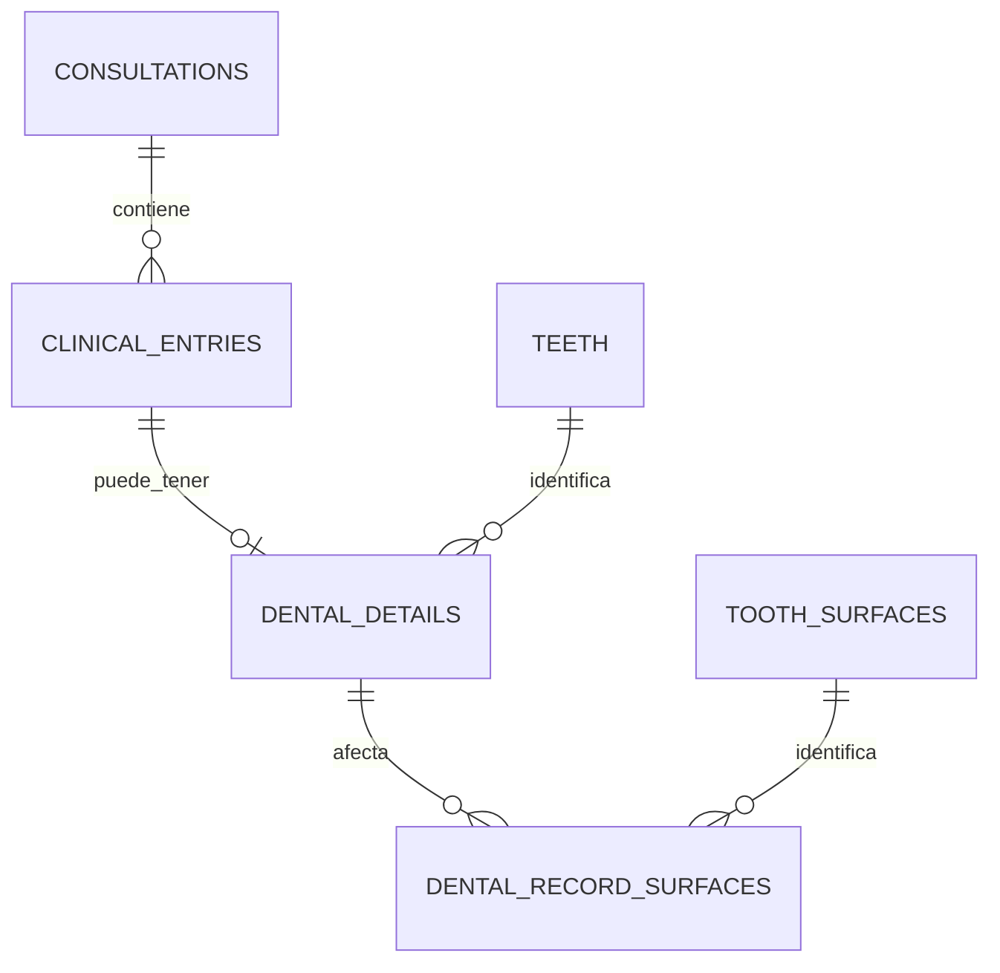

# 8. Un núcleo común con detalles por especialidad

Estado: propuesta de diseño, sin tablas ni catálogos importados. El usuario solicita que el modelo pueda servir a odontología, pediatría o medicina general y que dientes, superficies y opciones clínicas se obtengan de la base de datos.

## Catálogo y registro son cosas distintas

El catálogo dice qué opciones existen: una pieza dental, una superficie, un tipo de hallazgo. El registro dice qué ocurrió a una persona durante una atención. Tener «pieza 16» en el catálogo no significa que todos los pacientes la tengan presente; ese estado pertenece a su historia clínica.

Los datos comunes permanecen en usuarios, perfiles médicos, pacientes, expedientes y consultas. Reemplazamos la propuesta limitada a actuaciones dentales por `clinical_entries`, una base común para guardar el contexto y la autoría. Sus detalles se modelan según la necesidad real.

En esta primera extensión, un detalle dental corresponde a una pieza. Un registro puede afectar varias superficies mediante la tabla intermedia. Un procedimiento sobre varias piezas necesitará decidir si se registra por pieza o agrupa varios detalles; el diagrama no resuelve todavía ese caso.

## Qué compartir y qué separar

`clinical_entries` puede contener la consulta, la categoría de registro, el concepto seleccionado cuando aplique, descripción histórica, profesional responsable, fecha del hecho y usuario/fecha de captura. No todo registro es un procedimiento realizado: hay notas, observaciones y diagnósticos con significados distintos.

Una extensión dental agrega la pieza y superficies. Una futura medición pediátrica necesitaría valor, unidad y reglas apropiadas; no basta con cambiar una etiqueta de «diente» a «peso». No crearemos esa extensión hasta definir su uso. Evitamos una tabla inmensa con campos vacíos para todas las especialidades y una bolsa de JSON sin reglas para toda información clínica.

La distinción es compatible como orientación conceptual con FHIR, que separa [observaciones](https://hl7.org/fhir/R5/observation.html), [condiciones o diagnósticos](https://hl7.org/fhir/R5/condition.html) y [procedimientos](https://hl7.org/fhir/R5/procedure.html). Este esquema propio no implementa FHIR ni demuestra conformidad con él.

## Catálogos iniciales propuestos

| Catálogo              | Información y función                                                                                                                          |
| --------------------- | ---------------------------------------------------------------------------------------------------------------------------------------------- |
| `specialties`         | Código y nombre de la especialidad. Su relación con médicos se define según si pueden tener una o varias. No concede permisos automáticamente. |
| `clinical_concepts`   | Código local, categoría, etiqueta y estado activo de las opciones disponibles.                                                                 |
| `teeth`               | Código de pieza, dentición y posición necesaria para identificarla. No contiene el estado de un paciente.                                      |
| `tooth_surfaces`      | Código y nombre de la superficie.                                                                                                              |
| `tooth_surface_rules` | Combinaciones permitidas, revisadas clínicamente, para no aceptar una superficie incompatible con la pieza.                                    |

El backend debe comprobar la compatibilidad y que la opción siga disponible para nuevos registros; no basta con filtrar un select. El detalle de estas restricciones queda para el DDL. La tabla intermedia de superficies del registro es diferente de la tabla que enumera combinaciones permitidas del catálogo.

Cada catálogo tiene identificadores estables. Para un concepto externo necesitamos su sistema de origen, código y versión; el código solo no identifica universalmente un concepto. Los códigos locales siguen siendo locales, sin inventar equivalencias con estándares.

Las entradas usadas no se eliminan ni cambian de significado. Se desactivan para nuevas selecciones, manteniendo referencias y la descripción histórica. Una actualización de catálogos debe estar versionada y preservar los datos de la clínica; no reemplazarlos.

## Qué sigue viviendo en el código

La base aporta opciones y reglas de referencia. La interfaz sigue dibujando el odontograma, ubicando las piezas y mostrando formularios apropiados. Agregar una especialidad al catálogo no construye su módulo de atención. La disposición visual y las interacciones del diagrama no tienen que convertirse en filas de base de datos.

Para funcionar localmente, los catálogos necesarios se cargan mediante datos iniciales versionados. La pantalla no debería depender de consultar una API externa cada vez que se abre una pieza.

## Fuentes externas que sí existen

| Recurso                                                                                         | Qué aporta                                                                                          | Qué no asumir                                                                                                                                                             |
| ----------------------------------------------------------------------------------------------- | --------------------------------------------------------------------------------------------------- | ------------------------------------------------------------------------------------------------------------------------------------------------------------------------- |
| [SNOMED CT](https://www.snomed.org/what-is-snomed-ct)                                           | Terminología de conceptos clínicos, descripciones y relaciones, incluyendo contenido anatómico.     | No es una base lista para esta aplicación. Su [licenciamiento y distribución](https://www.snomed.org/get-snomed) requieren revisión para los territorios y usos elegidos. |
| [CIE / ICD de la OMS](https://www.who.int/standards/classifications/classification-of-diseases) | Clasificación de enfermedades y problemas relacionados con la salud.                                | No sustituye todos los catálogos anatómicos ni de procedimientos.                                                                                                         |
| [HL7 FHIR](https://hl7.org/fhir/R5/terminologies.html)                                          | Modelo de intercambio y mecanismos para representar códigos, conjuntos de opciones y equivalencias. | No es un motor de base de datos ni una lista universal que podamos importar sin adaptación.                                                                               |

FHIR [BodyStructure](https://hl7.org/fhir/R5/bodystructure.html) describe estructuras concretas de un paciente; no debe confundirse con nuestro catálogo general de regiones anatómicas. Si después necesitamos localizaciones no dentales, definiremos su catálogo y su relación con los registros, que pueden carecer de una localización específica.

## Siguiente paso pequeño

Inventariar las opciones dentales actuales y separar piezas, superficies, estados, hallazgos y tratamientos. Revisar su significado y combinaciones con el profesional de la clínica. Empezar con un catálogo local acotado, sin importar terminologías completas ni declarar equivalencias sin validación. Solo después de consensuar campos y relaciones se escribirán migraciones y datos iniciales.

Ampliación posterior propuesta: [brackets y actuaciones sobre varias piezas](11-orthodontics.md) revisa la relación inicial de un solo detalle dental por registro. Aún no está implementada.
