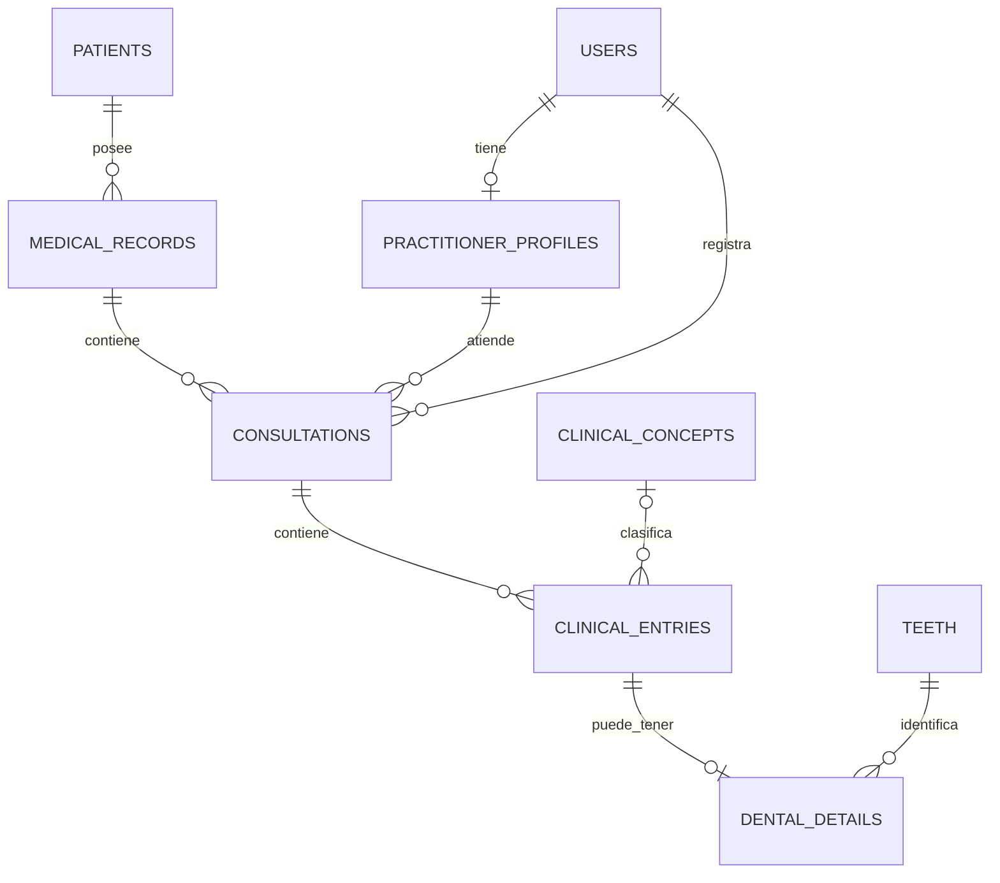

# 9. Propuesta de tablas y relaciones por bloques

El usuario acepta comenzar con un catálogo pequeño. Regla inicial acordada: un expediente por paciente en cada instalación y un médico responsable por consulta; las colaboraciones se mencionan en comentarios, sin una tabla de participantes por ahora. Otros campos y relaciones siguen por consensuar. No hay SQL ni migraciones ejecutadas.
**Decisión vigente:** nombres técnicos en inglés, relación `patients → medical_records` uno a muchos en BD y flujo inicial limitado a un expediente. Campos obligatorios propuestos y control de concurrencia en [campos obligatorios](10-required-fields.md). Esta decisión sustituye la unicidad de `patient_id` planteada inicialmente.

## Bloque 1: personas, cuentas y expediente

`id` identifica internamente cada fila mediante UUID v4 aleatorio. Un campo terminado en `_id` apunta a una fila de otra tabla y usa el tipo UUID correspondiente. Los códigos de catálogo mantienen su significado propio.

| Tabla                   | Campos candidatos                                                                                                                                                                      |
| ----------------------- | -------------------------------------------------------------------------------------------------------------------------------------------------------------------------------------- |
| `users`                 | `id`, nombre visible, activo. El identificador de acceso, autenticación y permisos se definirán aparte.                                                                                |
| `practitioner_profiles` | `id`, `user_id` único, identificación profesional si aplica. Especialidades se relacionarán mediante su catálogo cuando acordemos una o varias por médico.                             |
| `patients`              | `id` UUID y `full_name` obligatorios; `document_type`, `document_number`, `phone` y `date_of_birth` cuando estén disponibles. Comparación de posibles duplicados para revisión humana. |
| `medical_records`       | `id`, `patient_id` requerido y no único, código visible único e inmutable, antecedentes, observaciones generales, `created_by_user_id`, `created_at`, `archived_at` opcional.          |

Proponemos una cuenta con cero o un perfil médico. La regla inicial es un paciente con un expediente dentro de la instalación. Paciente y expediente se crean juntos en una transacción. El código de expediente se valida con la misma política de comparación que la interfaz; unicidad e inmutabilidad son reglas diferentes. La cuenta que creó el expediente no es su dueña ni el único médico que puede atenderlo.

Dos personas pueden compartir nombre y seguir siendo pacientes distintos. En cambio, no recomendamos duplicar a la misma persona para darle un segundo expediente: fragmentaría su historial. La relación admite varios expedientes por persona, manteniendo una sola identidad de paciente; el flujo actual limita el alta a uno. Esta recomendación responde a una alternativa planteada por el usuario; no autoriza implementar un flujo de múltiples expedientes.

Es posible encontrar registros de la misma persona en distintas instituciones; [FHIR Patient](https://hl7.org/fhir/R5/patient.html) contempla ese contexto. También existen episodios que agrupan varias atenciones por un problema o período: [FHIR EpisodeOfCare](https://hl7.org/fhir/R5/episodeofcare.html). Un episodio no equivale necesariamente a otro expediente ni obliga a duplicar al paciente. No añadimos esa estructura en esta versión.

## Bloque 2: atención e historia clínica

| Tabla              | Campos candidatos                                                                                                                                                                                                 |
| ------------------ | ----------------------------------------------------------------------------------------------------------------------------------------------------------------------------------------------------------------- |
| `consultations`    | `id`, `medical_record_id`, `responsible_practitioner_id`, fecha/hora de atención, motivo, observaciones, clasificación de atención, conclusión, `recorded_by_user_id`, `recorded_at`, `archived_at` opcional.     |
| `clinical_entries` | `id`, `consultation_id`, categoría de registro, `clinical_concept_id` cuando corresponda, descripción histórica, nota, `responsible_practitioner_id`, fecha/hora del hecho, `recorded_by_user_id`, `recorded_at`. |

Un expediente tiene cero o muchas consultas. Una consulta tiene cero o muchos registros. Cada registro pertenece a una consulta y llega al expediente a través de ella; no repetimos `patient_id` y `medical_record_id` en ese registro.

Se mantiene un médico responsable por consulta. Varios médicos pueden atender el mismo expediente en consultas distintas. La relación muchos a muchos de atención se obtiene por ese historial; una tabla de asignaciones tendría otra finalidad y no se añade sin acordarla. Las colaboraciones se mencionarán en el comentario de la consulta. Ese texto no verifica la identidad del colaborador ni permite consultar su participación como una relación estructurada; si eso se necesita, revisaremos el modelo. El autor real de cada registro permanece identificado por su cuenta, aunque el comentario mencione a otras personas.

La categoría distingue qué significa un registro: estado, hallazgo, procedimiento, nota u otros tipos que se definan. Los campos específicos y las reglas de cada tipo deben detallarse al implementarlo; este encabezado no resuelve por sí solo mediciones, diagnósticos y procedimientos de todas las especialidades.

## Bloque 3: odontología y catálogo pequeño

| Tabla                    | Función y relación                                                                                                                                                       |
| ------------------------ | ------------------------------------------------------------------------------------------------------------------------------------------------------------------------ |
| `clinical_concepts`      | Opciones locales de estados, hallazgos y tratamientos: ID, código estable único, categoría, etiqueta, activo. Un concepto puede estar referenciado por muchos registros. |
| `teeth`                  | Código de pieza, dentición y nombre. Una pieza del catálogo puede aparecer en detalles de muchos pacientes.                                                              |
| `tooth_surfaces`         | Código y nombre de las superficies.                                                                                                                                      |
| `tooth_surface_rules`    | Pares únicos de pieza y superficie que el catálogo permite; revisión clínica pendiente.                                                                                  |
| `dental_details`         | `clinical_entry_id` único y `tooth_id`. Un registro puede tener cero o un detalle dental en esta propuesta inicial.                                                      |
| `dental_record_surfaces` | Pares únicos de detalle dental y superficie afectada; permite cero o varias superficies por detalle. Deben corresponder a combinaciones válidas de la pieza.             |

Las últimas dos relaciones de superficies hacen trabajos diferentes: una declara lo permitido en el catálogo y otra lo seleccionado en la atención. La implementación debe garantizar compatibilidad también al cambiar una pieza, no solo al insertar una superficie.

Un detalle representa una pieza; los procedimientos sobre múltiples piezas requieren acordar agrupación o registros separados. No se ha aprobado esa limitación como regla clínica definitiva. El estado de la pieza de un paciente se obtiene de sus registros, no cambiando el catálogo común.

## Diagrama del recorrido principal

El diagrama omite autoría de registros y relaciones de superficies por legibilidad; están especificadas en las tablas anteriores. No implica que todo registro requiera un concepto del catálogo o detalle dental.

## Ejemplo para comprobar el modelo

1. Paciente de ejemplo tiene el expediente EXP-DEMO.
2. La doctora A atiende la consulta C1; recepción la registra con su propia cuenta.
3. C1 contiene un hallazgo R1, con concepto local y detalle de pieza 16, superficie oclusal.
4. El doctor B atiende después la consulta C2 del mismo expediente y crea otro registro.
5. Una nota general dentro de C2 no necesita detalle dental.

Antes de SQL: acordar acceso a expedientes, tratamiento de procedimientos sobre varias piezas y campos obligatorios del bloque 1. Un expediente por paciente y un responsable por consulta son las reglas iniciales vigentes. No se crea una base por médico ni una tabla por cada pieza o paciente.

Ampliación posterior propuesta: [brackets y actuaciones sobre varias piezas](11-orthodontics.md) revisa la relación inicial de un solo detalle dental por registro. Aún no está implementada.
