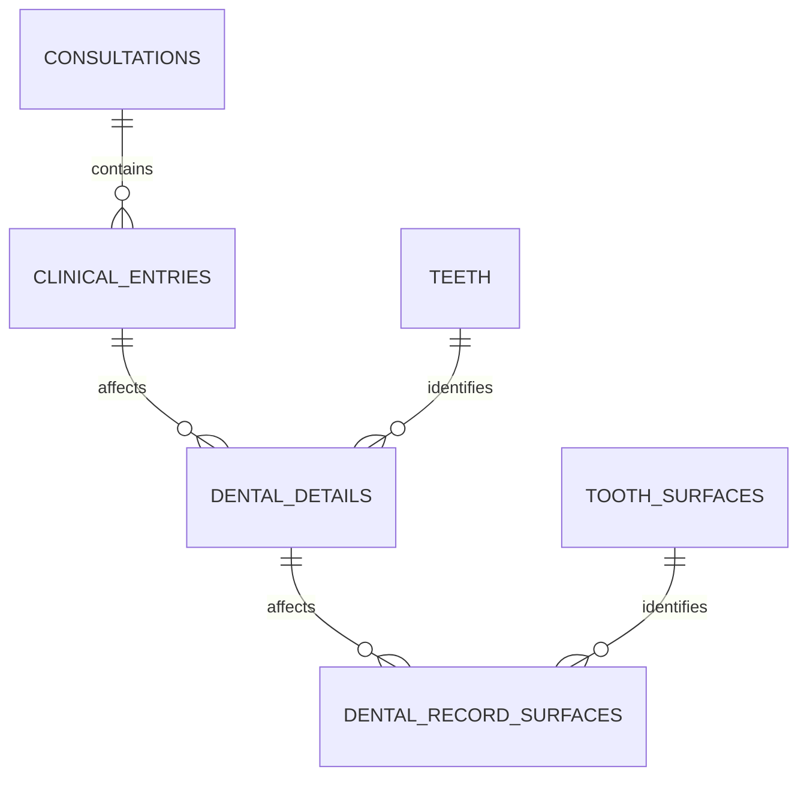

# 11. Brackets: alcance y relación con el historial

El usuario señala que faltaba contemplar brackets. Esta nota propone cómo incorporarlos al modelo, sin implementar UI ni un módulo completo de ortodoncia. Debe revisarse con el profesional de la clínica.

Actualización: selección de varias piezas para una actuación aceptada. El usuario solicita acceso/sección de ortodoncia desde el odontograma, campos flexibles para casos variados y revisar iconografía faltante. Investigación y propuesta de frontend en [interfaz de ortodoncia e iconografía](12-orthodontics-ui-research.md); no implementar todavía este esquema como si ya estuviera cerrado.

## Eventos y estado son diferentes

El catálogo pequeño puede incorporar conceptos locales de colocación, ajuste, retiro y observación de aparato presente. Son candidatos para validar, no códigos externos homologados. La AAO describe brackets, arcos y distintas etapas de tratamiento en su [introducción a aparatos fijos](https://aaoinfo.org/treatments/braces/); esos detalles clínicos no se deducen solo de una etiqueta «brackets».

Cada actuación se registra en una consulta mediante `clinical_entries`, con fecha, profesional y autor. La colocación y el retiro son eventos distintos: retirar un aparato no elimina la colocación anterior. Observar que un paciente ya lleva brackets tampoco demuestra que esta clínica los colocó.

Los brackets no reemplazan hallazgos ni el estado físico de la pieza. La vista del odontograma necesitaría una representación adicional y una leyenda comprensible. Todavía no se define el símbolo ni la regla completa para reconstruir el aparato presente a una fecha.

## Una actuación puede afectar varias piezas

La propuesta previa de cero o un `dental_details` por registro sería insuficiente para agrupar una actuación sobre varias piezas. Se propone ampliar esa relación a cero o muchos detalles, cada uno para una pieza:

`dental_details` tendría `id` UUID, `clinical_entry_id`, `tooth_id` y unicidad de la pareja registro/pieza. Se elimina la unicidad de `clinical_entry_id` por sí solo. Las superficies seleccionadas pertenecen al detalle de cada pieza; no se copian automáticamente a todas las piezas. Cero superficies puede ser válido según el registro; la semántica debe revisarse con el profesional.

Ejemplo ficticio: una consulta contiene un registro de colocación y varios detalles que enumeran las piezas realmente involucradas. Una atención posterior agrega otro registro de ajuste, conservando el anterior. No asumimos que una actuación afecta toda una arcada solo porque su concepto mencione brackets.

## Dos alcances a distinguir

- Registrar actuaciones y notas de ortodoncia dentro del expediente actual, con piezas y fechas: propuesta inicial pequeña.
- Gestionar un tratamiento ortodóntico longitudinal con aparato, inicio/fin, arcadas, controles y planificación: requiere definir su entidad y su ciclo de vida antes de implementar esa función. No se declara resuelto por añadir conceptos al catálogo.

El soporte de colocación/ajuste/retiro como historia no basta para mostrar de forma fiable el aparato actualmente activo si existen registros antiguos, retiros parciales o datos incompletos. Antes de construir esa visualización, acordar alcance y reglas; no inferir ausencia de aparato a partir de ausencia de registros.

## Prototipo local de UI, 2 de noviembre de 2026

Implementado en OdontoSoft sobre datos ficticios: activar modo ortodoncia, seleccionar varias piezas en los dibujos del odontograma y Confirmar piezas para abrir el modal. Se preselecciona la cita activa y se permite cambiarla. Campos flexibles: valoración/objetivo, descripción obligatoria, evolución, siguiente paso y aparatología opcional. Cambiar piezas conserva el formulario; cancelar protege el borrador. Una actuación se muestra una vez en el resumen de la cita y queda accesible desde sus piezas.

El contrato de presentación usa `ToothEvent.teeth` y detalles `orthodontics`, no tablas nuevas. Colocación/presencia documentada añade marcador; retiro lo quita por pieza y fecha; un ajuste solo no lo añade. No representa todos los aparatos ni un tratamiento longitudinal, ni demuestra ausencia de aparato cuando no existe registro. Pendiente validación profesional. Esta ampliación de UI no crea BD, migraciones ni persistencia: recargar borra los cambios.

Las superficies habituales varían según pieza y arcada. Otra localización conserva texto libre sin inventar un código anatómico. Referencias: [superficies dentales, Dentalcare](https://www.dentalcare.com/en-us/ce-courses/ce500/surfaces-of-the-teeth) y [áreas de tratamiento, Open Dental](https://www.opendental.com/manual/procedureedit.html).
